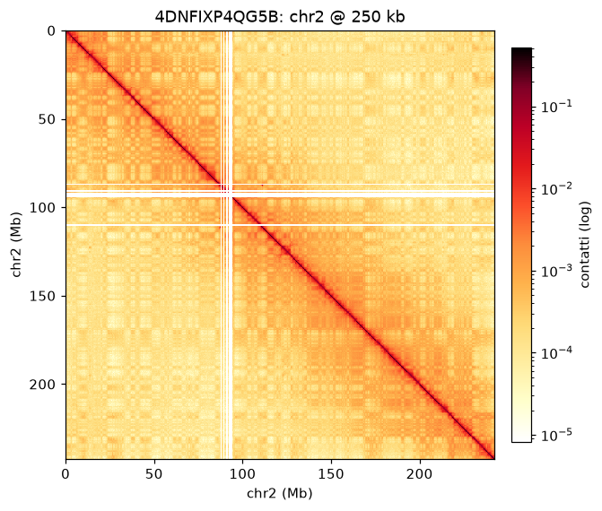
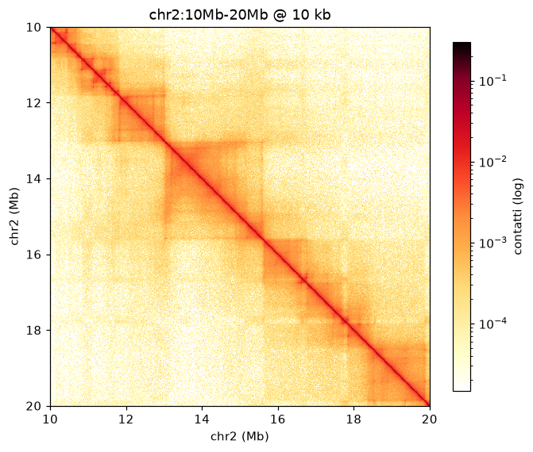
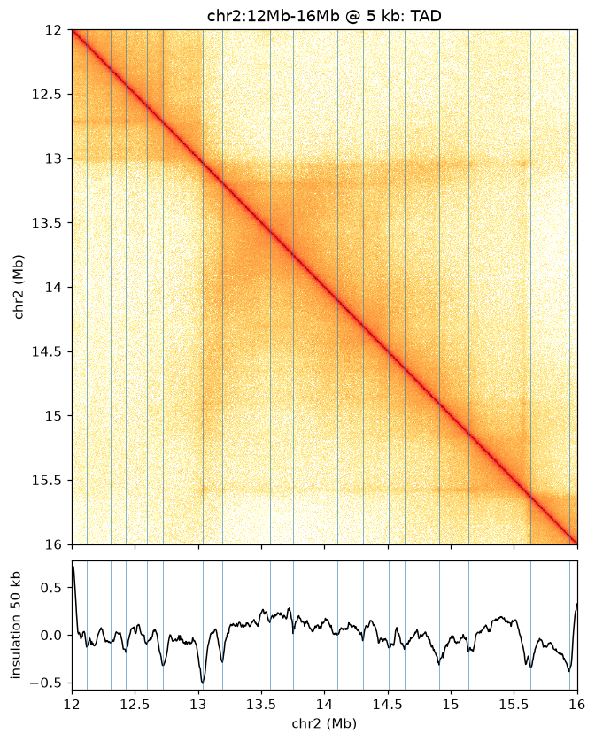
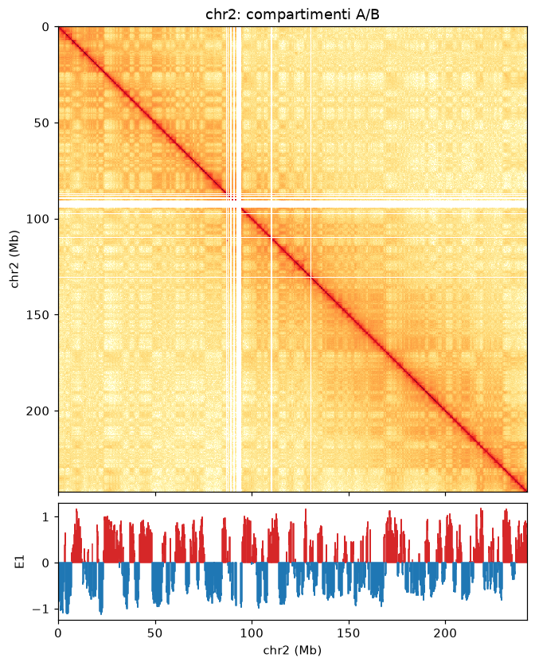
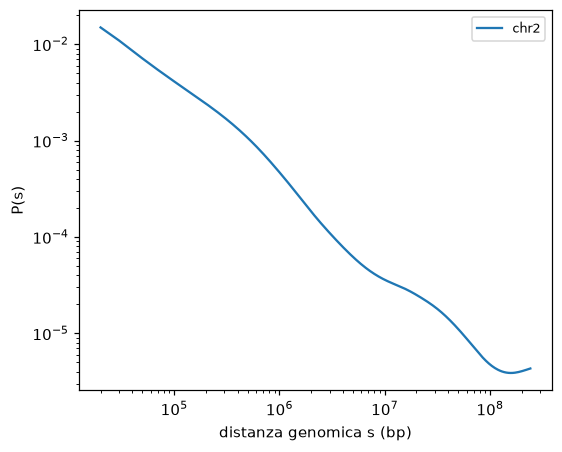
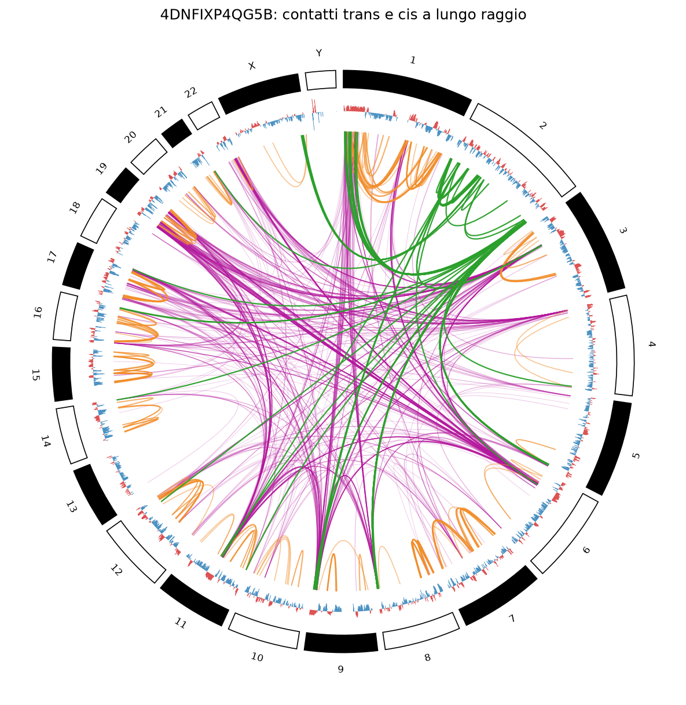

# clew — analisi e visualizzazione locale di matrici Hi-C

*Clew*: gomitolo, il filo di Arianna per uscire dal labirinto. Qui serve a dipanare la cromatina.

Ambiente per esplorare matrici di contatto Hi-C **già processate e bilanciate** (`.mcool`) su hg38 e mm10, dalla vista whole-genome (1 Mb) allo zoom sui TAD (5 kb).
Non c'è nessuna pipeline di allineamento: si parte dai file del 4DN Data Portal, di ENCODE o di GEO.

```
.
├── data/                 # .mcool e genomi (fuori da git, in sola lettura nei container)
├── notebooks/            # 01_explore.ipynb: esempio end-to-end su chr2
├── clew/                 # il pacchetto: `import clew`
│   ├── hic_io.py         # lettura per regione e heatmap
│   ├── analysis.py       # P(s), compartimenti A/B, insulation, confini di TAD (+ CLI)
│   ├── circos.py         # vista circolare dei contatti trans
│   ├── synthetic.py      # .mcool sintetico con struttura nota (test e demo)
│   └── ingest_higlass.py # registra .mcool nel server HiGlass e crea la vista
├── tests/                # pytest su dati sintetici
├── scripts/              # download di genoma e .mcool, figure del README
├── docs/img/             # figure del README (GM12878)
├── docker/Dockerfile
├── docker-compose.yml    # servizi lab (JupyterLab), worker (batch), higlass (viz)
├── pyproject.toml        # dipendenze (progetto `clew-hic`)
├── uv.lock               # versioni esatte, usate da Docker e da `uv sync`
└── Makefile
```

## Esempi su dati reali

Figure generate da `scripts/readme_figures.py` sul dataset **GM12878 in situ Hi-C** del 4DN, file [`4DNFIXP4QG5B`](https://data.4dnucleome.org/files-processed/4DNFIXP4QG5B/): 4,01 miliardi di contatti, MboI, 72 librerie unite, dati di Rao et al. 2014, hg38.
Per rigenerarle: `make mcool ACC=4DNFIXP4QG5B && uv run python scripts/readme_figures.py data/4DNFIXP4QG5B.mcool`. Ci vogliono circa 5 minuti, con un picco di circa 6 GB di RAM.

| | |
|---|---|
|  |  |
| **chr2 a 250 kb.** La scacchiera fuori dalla diagonale sono i compartimenti A/B. La banda bianca a circa 93 Mb è il centromero: DNA ripetuto, nessuna lettura mappabile, bin esclusi dal bilanciamento. | **chr2:10–20 Mb a 10 kb.** I quadrati lungo la diagonale sono i TAD. A questa profondità sono già visibili domini annidati. |
|  |  |
| **chr2:12–16 Mb a 5 kb.** Insulation score con finestra di 50 kb. Le linee blu sono i confini chiamati (soglia di Li): cadono nei minimi della curva, dove i contatti non attraversano il confine. | **Compartimenti di chr2 a 100 kb.** E1 orientato con il contenuto GC di hg38: rosso = A (attivo, ricco in GC), blu = B. I blocchi seguono la scacchiera della matrice. |
|  |  |
| **P(s) di chr2.** Pendenza circa −1 tra 100 kb e 1 Mb, tipica della cromatina in interfase, poi più ripida oltre i TAD. La risalita oltre 100 Mb è un effetto di bordo: a quelle distanze restano pochissime coppie di bin. | **Circos a 1 Mb.** In magenta i contatti trans, in arancione i cis oltre 10 Mb, in verde chr2. Le corde si addensano sui cromosomi piccoli e ricchi di geni (19, 22, 17), al centro del nucleo, e sono rare su 18, 13 e X, più periferici. Fra le più forti c'è chr1:149 Mb ↔ chr6:26 Mb, i due cluster dei geni istonici (HIST2 e HIST1), noti per raccogliersi insieme. Altre corde forti, come chr2:87 Mb ↔ chrX:144 Mb, non sono interpretate e vanno verificate. |

## 1. Ambiente

Le dipendenze sono dichiarate in `pyproject.toml` e bloccate in `uv.lock`, gestite con [uv](https://docs.astral.sh/uv/). Le stesse versioni esatte finiscono nell'immagine Docker (consigliato) e in un venv locale.

### Con Docker (consigliato)

Serve solo Docker con il plugin Compose.

```bash
make build      # costruisce l'immagine clew-env (1,5 GB; ~3-8 min la prima volta)
make test       # 40 test su dati sintetici, in un container usa-e-getta
make notebook   # avvia JupyterLab e apre notebooks/01_explore.ipynb nel browser
```

`make notebook NB=notebooks/altro.ipynb` apre un altro notebook. Senza un display grafico, stampa l'URL (`http://127.0.0.1:8888/lab/tree/…?token=…`) da aprire a mano.

| Comando | Effetto |
|---|---|
| `make notebook` | avvia JupyterLab (se serve) e apre il notebook nel browser |
| `make up` / `make url` | avvia JupyterLab / ristampa l'URL con il token |
| `make logs` / `make shell` | log del server / shell nel container |
| `make stop` | ferma i container (si riavviano con `make up`) |
| `make down` | rimuove container e rete; immagine e dati restano |
| `make clean` | come `down`, più l'immagine `clew-env` e la cache di build |
| `make distclean` | come `clean`, più cache Python e `results/`; `data/` non viene mai toccata |
| `make higlass` / `make higlass-ingest FILES=…` | avvia HiGlass / registra file e apre la vista |
| `make genome ASM=hg38` | scarica il genoma di riferimento in `data/genomes/` |
| `make mcool ACC=…` | scarica un `.mcool` dal 4DN Data Portal in `data/` |

Cosa fa il container `lab`:
- espone JupyterLab **solo su 127.0.0.1**, protetto da un token;
- monta il progetto in `/work`, ma `data/` è in **sola lettura**; gli output vanno in `results/`;
- gira con il tuo UID, così i file creati restano tuoi;
- ha limiti di RAM e CPU configurabili in `.env` (creato da `make env` a partire da `.env.example`).

Default: 16 GB per `lab` e 6 GB per ogni `worker`, su 32 GB totali.

**Job batch e parallelismo.** Il servizio `worker` usa la stessa immagine e gli stessi mount, ma ogni job gira nel suo container, che viene eliminato alla fine:

```bash
docker compose run --rm worker python -m clew.analysis insulation data/4DNFIXVAKX9Q.mcool \
    --res 10000 --region chr2 --out results/gm12878_chr2_insulation.tsv
```

Le analisi disponibili sono `ps`, `compartments` (con `--fasta` per orientare E1), `insulation` e `boundaries`. Per lavorare in parallelo lanci più `run` contemporaneamente, per esempio un cromosoma o un campione ciascuno: ognuno ha il proprio limite di RAM (`WORKER_MEM`).

### Con uv (senza Docker)

```bash
uv sync                     # crea .venv con Python 3.11 e le versioni di uv.lock
uv run pytest
uv run jupyter lab
```

Serve un compilatore C (`gcc`, su Arch nel gruppo `base-devel`): **cooltools 0.7.1 su PyPI esiste solo come sorgente** e uv lo compila al primo `sync`, in circa un minuto. Nel Dockerfile la compilazione avviene in uno stadio separato, così l'immagine finale non contiene compilatori.

Per aggiungere una dipendenza: `uv add nome`, che aggiorna sia `pyproject.toml` sia `uv.lock`. Poi `make build`.

**Vincoli voluti** (commentati in `pyproject.toml`):
- `pandas<3`: cooler non lo supporta ancora;
- `cooltools` richiede `numpy` e `cython` per compilare (`[tool.uv.extra-build-dependencies]`), perché il suo sorgente non li dichiara;
- la colormap `fall` è registrata in `clew/hic_io.py`, perché `cooltools.lib.plotting` (0.7.1) non si importa con matplotlib ≥ 3.9.

## 2. Dati

### Genoma di riferimento

```bash
make genome            # hg38 da UCSC: ~1 GB scaricato, 3,1 GB decompresso, + indice .fai
make genome ASM=mm10
```

Lo script verifica l'MD5 contro il `md5sum.txt` ufficiale di UCSC. Il genoma serve per orientare i compartimenti con il contenuto GC (E1 > 0 = A).

Il FASTA è **soft-masked**: le ripetizioni (circa metà del genoma) sono in minuscolo. Per il calcolo del GC non fa differenza.

### Matrici dal 4DN Data Portal

Tutti i file sotto sono **hg38 (GRCh38)**, processati con la pipeline 4DN e **già bilanciati** (colonna `weight`), con risoluzioni da 1 kb a 10 Mb (1, 2, 5, 10, 25, 50, 100, 250, 500 kb, 1, 2.5, 5, 10 Mb). Sono pubblici: non serve un account.

```bash
make mcool ACC=4DNFIXVAKX9Q
```

Lo script legge URL e MD5 dall'API 4DN, controlla lo spazio libero, riprende il download se viene interrotto e verifica l'MD5 alla fine.

| Linea | Accession | Dimensione | Esperimento | Quando usarlo |
|---|---|---|---|---|
| GM12878 | **`4DNFIXVAKX9Q`** | 3,9 GB | in situ Hi-C, DpnII, repliche unite (exp. set `4DNESQWI9K2F`, Aiden lab) | **per iniziare**: download veloce |
| GM12878 | **`4DNFIXP4QG5B`** | 27,4 GB | in situ Hi-C, MboI, protocollo di riferimento, repliche unite (`4DNES3JX38V5`, dati Rao et al. 2014) | massima profondità, loop e zoom a 5 kb; il notebook lo cerca per primo |
| HFFc6 | **`4DNFIT3ABRQL`** | 11,3 GB | in situ Hi-C, DpnII, repliche unite (`4DNES2R6PUEK`, Dekker lab) | linea Tier 1 del 4DN |
| HFFc6 | `4DNFIB59T7NN` | 22,8 GB | stesso exp. set, versione più profonda | massima profondità |
| HFFc6 | `4DNFI9FVHJZQ` | 11,1 GB | Micro-C (`4DNESWST3UBH`) | risoluzione fine (nucleosomi, loop) |

I file si cercano sul portale: <https://data.4dnucleome.org>, poi *Browse → Experiment Sets*, filtrando per *Biosource* e *Experiment type*, e scaricando il file `mcool` dalla scheda *Processed Files*. Prima di usare 5 kb, controlla nella scheda del file il quality metric **"Failed Balancing"**: nei dataset poco profondi il bilanciamento fallisce alle risoluzioni fini.

**ENCODE e GEO.** Se trovi un `.mcool`, va bene così com'è. I `.hic` (Juicer) vanno convertiti, perché `hic_io` li rifiuta con un messaggio esplicito:

```bash
hictk convert in.hic out.mcool         # hictk è su bioconda
```

Verifica che il file sia bilanciato: `cooler ls file.mcool`, poi `cooler info file.mcool::/resolutions/10000`, e controlla che ci sia la colonna `weight`. Altrimenti bilancialo con `cooler balance`.

## 3. Quale risoluzione per quale vista

| Vista / analisi | Risoluzione | Note |
|---|---|---|
| Genoma intero (tutti i cromosomi, trans) | **250 kb – 1 Mb** | 1 Mb ≈ 3 100 bin; 250 kb ≈ 12 400 bin |
| Cromosoma intero | 100 – 250 kb | compartimenti visibili come scacchiera |
| Compartimenti A/B (E1) | **100 kb** (50 – 250 kb) | `eigs_cis` legge la matrice cis intera di ogni regione |
| P(s) | 10 – 25 kb | `expected_cis` lavora a blocchi: va bene anche su tutto il cromosoma |
| TAD / insulation | 10 – 25 kb | finestre di 5, 10 e 25 bin |
| **Zoom** su TAD e loop | **5 – 10 kb** | finestre di 1 – 10 Mb; 5 kb solo con dataset profondi |

Il genoma intero non passa da `fetch_region`, che è solo cis. Si legge direttamente, **solo a bassa risoluzione**:

```python
from clew import hic_io
clr = hic_io.open_cooler("data/4DNFIXVAKX9Q.mcool", 1_000_000)
mat = clr.matrix(balance=True)[:]     # ~3 100 x 3 100 bin, 77 MB
```

## 4. Quanta RAM serve

Una matrice densa di *n* bin occupa *n*² × 8 byte (float64). Nella pratica conviene prevedere **2–3 volte** tanto: matplotlib crea copie mascherate e normalizzate durante il disegno.

| Risoluzione | Finestra di 10 Mb | chr1 intero (249 Mb) | Genoma intero (3,1 Gb) |
|---|---|---|---|
| 1 Mb | — | 0,5 MB (249 bin) | **76 MB** (3 088 bin) |
| 500 kb | — | 2 MB | **305 MB** |
| 250 kb | 13 kB | 8 MB | **1,2 GB** |
| 100 kb | 80 kB | 50 MB | 7,6 GB ✗ |
| 50 kb | 0,3 MB | 198 MB | 30 GB ✗ |
| 25 kb | 1 MB | 793 MB | ✗ |
| 10 kb | **8 MB** | 5 GB ✗ | ✗ |
| 5 kb | **32 MB** (2 000 bin) | 20 GB ✗ | ✗ |

✗ = da non fare su 32 GB.

Regole pratiche:
- **Zoom ad alta risoluzione solo per finestre.** 5–10 kb vanno bene fino a circa 20 Mb (4 000 bin, ~130 MB). `fetch_region` rifiuta oltre `max_bins=5000` per lato (~200 MB) e suggerisce di abbassare la risoluzione.
- **P(s) e insulation** leggono i pixel a blocchi dal file HDF5. Con i default di cooltools (10–20 milioni di pixel per blocco), su `4DNFIXP4QG5B` ogni processo arrivava a **4,6 GB**: con `nproc=4` il picco sarebbe stato di circa 19 GB. clew usa blocchi da 2 milioni (`analysis.CHUNKSIZE`): **1,1–1,3 GB per processo**, stesso risultato e solo l'11% di tempo in più (misurato su chr2 a 10 kb).
- **Compartimenti**: a 100 kb, chr1 occupa ~50 MB per matrice. A 25 kb sarebbero ~0,8 GB, più le copie interne di cooltools.
- Il file `.mcool` resta su disco e viene letto solo per la parte richiesta: un file da 27 GB non occupa 27 GB di RAM.

## 5. Uso da Python

```python
from clew import analysis, hic_io

path = "data/4DNFIXVAKX9Q.mcool"
hic_io.list_resolutions(path)

mat = hic_io.fetch_region(path, 10_000, "chr2:10,000,000-20,000,000")
hic_io.plot_matrix(mat, "chr2:10,000,000-20,000,000", out="results/zoom.png")
hic_io.plot_pair(path, 10_000, "chr2:10Mb-15Mb", "chr2:150Mb-155Mb")

clr = hic_io.open_cooler(path, 10_000)
cvd = analysis.contact_probability(clr, "chr2")                 # P(s) + pendenza
ins = analysis.insulation(clr, regions="chr2:10Mb-60Mb")        # 50/100/250 kb
tads = analysis.tad_boundaries(clr, insulation_df=ins)          # confini (soglia Li)

clr100 = hic_io.open_cooler(path, 100_000)
gc = analysis.gc_phasing_track(clr100, "data/genomes/hg38/hg38.fa", "chr2")
eigs = analysis.compartments(clr100, gc, "chr2")                # E1 + colonna A/B
```

**Vista circolare (Circos)** del genoma intero, a bassa risoluzione. L'anello interno mostra E1 (rosso = A, blu = B).
- **Corde magenta (trans):** contatti tra cromosomi diversi più alti della media di quella coppia di cromosomi.
- **Petali arancioni (cis a lungo raggio):** contatti nello stesso cromosoma, oltre `min_distance`, più alti dell'atteso per la loro distanza (la media della diagonale).
- **Corde verdi:** quelle che toccano la regione evidenziata.

```python
import pandas as pd
from clew.circos import cis_links, plot_circos, trans_links

clr1m = hic_io.open_cooler(path, 1_000_000)               # ~3 100 bin, 76 MB
chroms = list(analysis.make_view(clr1m)["chrom"])
links = pd.concat([trans_links(clr1m, chroms, top_n=1000),
                   cis_links(clr1m, chroms, min_distance=10_000_000, top_n=300)])
e1 = analysis.compartments(clr1m, analysis.gc_phasing_track(clr1m, "data/genomes/hg38/hg38.fa"))
plot_circos(clr1m.chromsizes[chroms], links, track=e1, highlight="chr2", out="results/circos.png")
```

`trans_links` e `cis_links` rifiutano le matrici oltre 5 000 bin: per il Circos usa 500 kb – 1 Mb.

**Filtri contro gli artefatti.** Senza filtri, le corde "più arricchite" cadono quasi tutte su regioni dove le letture mappano male:
- bordi dei centromeri (DNA satellite);
- estremità dei cromosomi;
- bracci corti degli acrocentrici;
- chrY in una linea femminile come GM12878. Le sue letture vengono da regioni quasi identiche su chrX, per esempio la regione X-trasposta chrX:89–93 Mb ↔ chrY:3–6 Mb.

Per questo entrambe le funzioni escludono i cromosomi con meno del 50% di bin validi (`min_valid_frac`) e i bin entro 2 bin da un buco o da un'estremità (`edge_bins`). Su `4DNFIXP4QG5B` questo ha tolto chrY, che prima occupava 306 estremi di corda su 2 000, e tutti i picchi pericentromerici.

Perché cis e trans sono trattati in modo diverso: i contatti cis seguono il filo del cromosoma e calano con la distanza, quindi l'atteso dipende da quanto sono lontani i due punti. I trans avvengono solo ai bordi dei territori cromosomici, quindi l'atteso è una media per coppia di cromosomi. Per questo nel grafico le due intensità sono scalate separatamente.

Ogni funzione di `analysis` prende un `cooler.Cooler` e ritorna un `DataFrame`. Il parametro `regions` accetta nomi di cromosoma o regioni UCSC.

> **Attenzione alle unità nelle regioni**: scrivi `chr2:10Mb-15Mb` oppure `chr2:10,000,000-15,000,000`. Con `chr2:10-15Mb` cooler legge l'inizio come **10 bp**, senza dare errore.

Il notebook `notebooks/01_explore.ipynb` mette tutto insieme su chr2. Se il `.mcool` non è in `data/`, usa il dataset sintetico (TAD da 200 kb, compartimenti da 400 kb), così gira comunque.

## 6. HiGlass: esplorazione interattiva nel browser

HiGlass mostra le matrici come una mappa (stile Google Maps): zoom continuo dal genoma intero fino a 1 kb, con le tile calcolate al volo dal `.mcool`.

```bash
make higlass-ingest FILES=data/4DNFIXP4QG5B.mcool REGION=chr2:10Mb-20Mb
```

Il comando avvia il server (se serve), registra il file e apre nel browser la vista, all'indirizzo `http://127.0.0.1:8989/app/?config=…`. Per confrontare due campioni affiancati, con zoom e posizione sincronizzati:

```bash
make higlass-ingest FILES="data/4DNFIXP4QG5B.mcool data/4DNFIT3ABRQL.mcool" REGION=chr2
```

**Come funziona:**
- **Server:** il servizio `higlass` (profilo `viz`) usa l'immagine ufficiale `higlass/higlass-docker:0.10.4`. È esposto solo su 127.0.0.1:8989, con limiti in `.env` (`HIGLASS_MEM`, `HIGLASS_CPUS`, `HIGLASS_WORKERS` processi che servono le tile in parallelo).
- **Nessuna copia dei dati:** `data/` è montata in sola lettura dentro la cartella media del server. `clew/ingest_higlass.py` registra ogni `.mcool` per percorso con l'API `POST /api/v1/link_tile/`, quindi un file da 27 GB è disponibile in un secondo. Solo le dimensioni dei cromosomi (pochi kB) vengono caricate via upload, per le etichette degli assi, nello stesso ordine del file.
- **Idempotente:** gli identificativi derivano dal percorso dentro `data/` (`4DNFIXP4QG5B`, `demo_synthetic`…) e dal contenuto del viewconf. Rilanciare il comando riusa ciò che esiste.
- **Persistenza:** il database del server (registrazioni e viste salvate) sta nel volume Docker `clew_higlass-db`. Sopravvive a `make down` e viene eliminato solo da `make clean`.
- **Autenticazione:** l'API accetta nuove registrazioni solo da un utente, che `make higlass` crea con la password casuale generata in `.env` (`HIGLASS_USER` / `HIGLASS_PASSWORD`).

Lo script si può usare anche direttamente, dal container `worker`, che raggiunge il server sulla rete interna:

```bash
docker compose run --rm worker python -m clew.ingest_higlass data/x.mcool --assembly mm10 --region chr11
```

Solo i file dentro `data/` sono visibili al server: lo script rifiuta gli altri con un errore esplicito. Per HiGlass servono `.mcool` multi-risoluzione e bilanciati, come quelli del 4DN.

## 7. Test

```bash
make test                   # in Docker
python -m pytest            # in locale, con l'ambiente attivo
```

I test usano un `.mcool` sintetico (`clew/synthetic.py`) con struttura nota. Verificano lettura per regione, limite di memoria, grafici, decadimento di P(s), recupero dei compartimenti A/B dal segno di E1, posizione dei confini di TAD, CLI, Circos (un hotspot trans e uno cis noti devono risultare le prime corde), e per HiGlass mappatura dei percorsi, identificativi, coordinate e viewconf. La registrazione vera richiede il server attivo e non è nei test automatici.
# clew-hic
